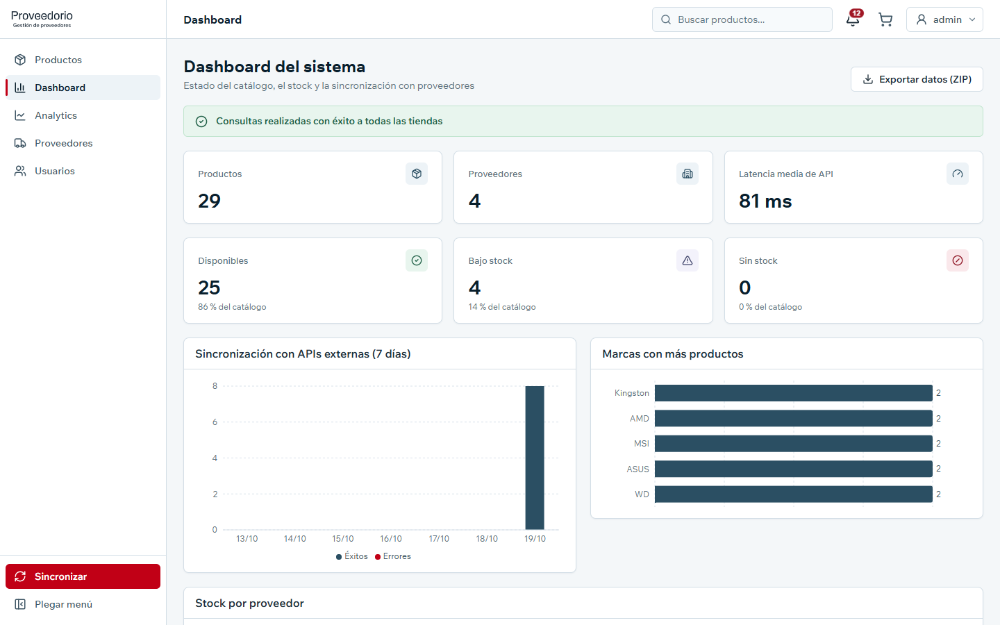
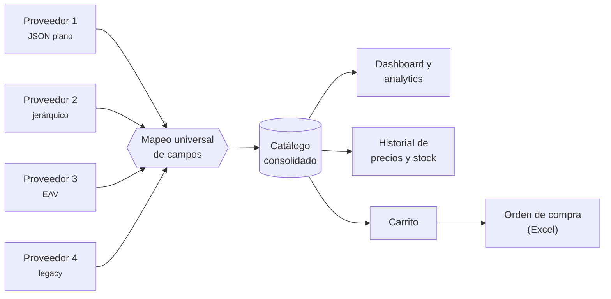
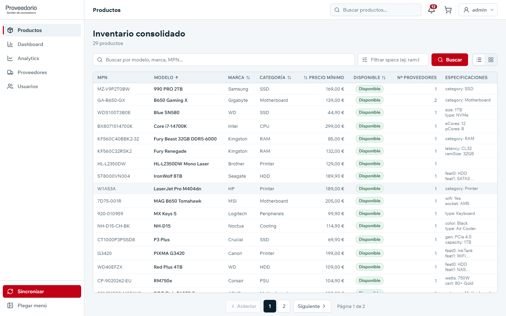
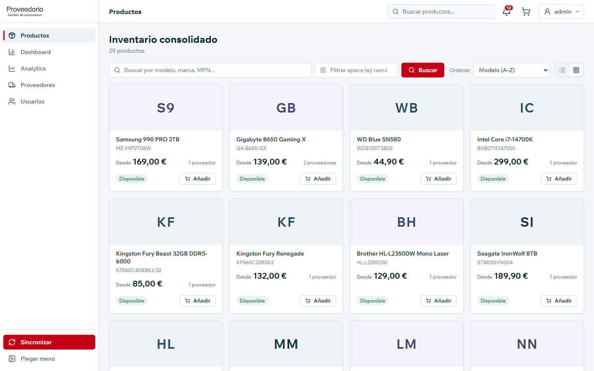
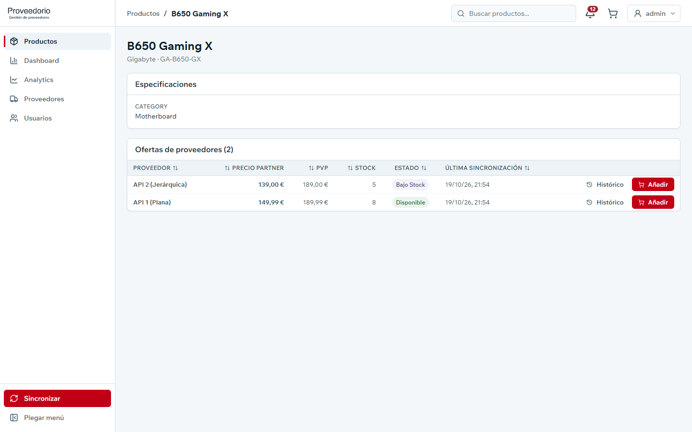
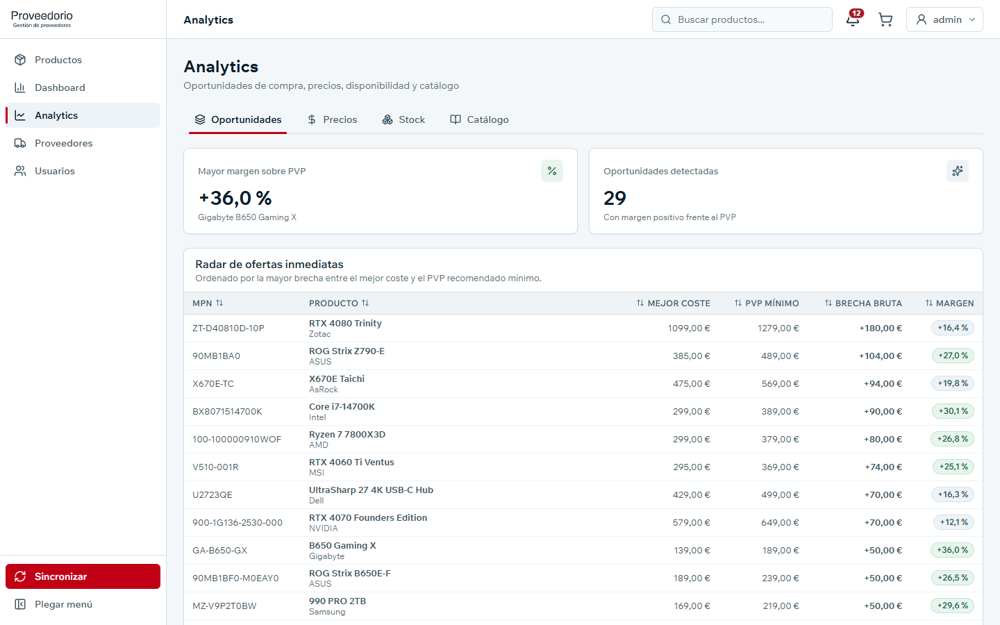
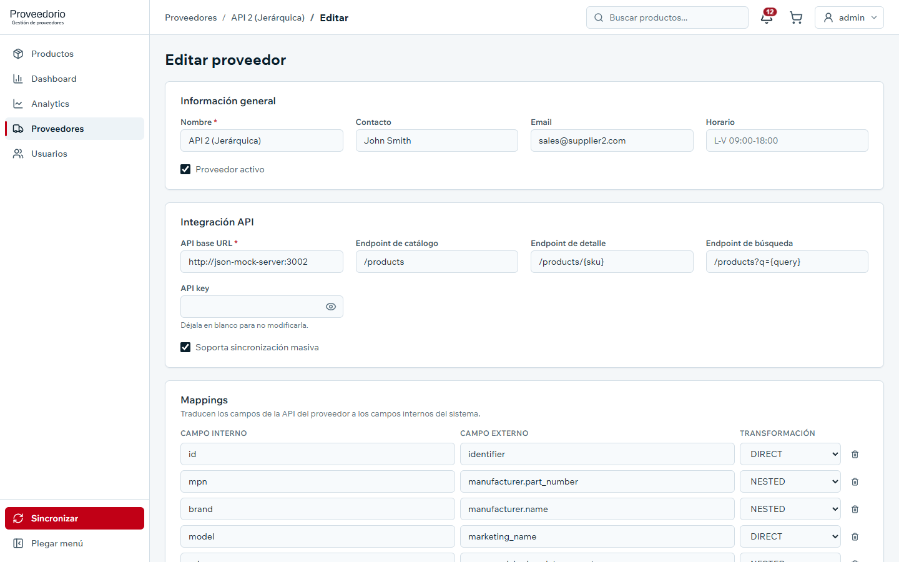
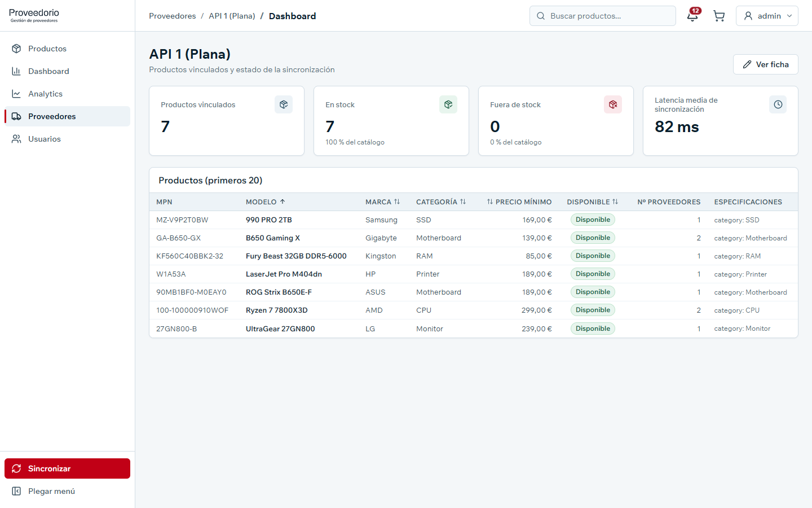
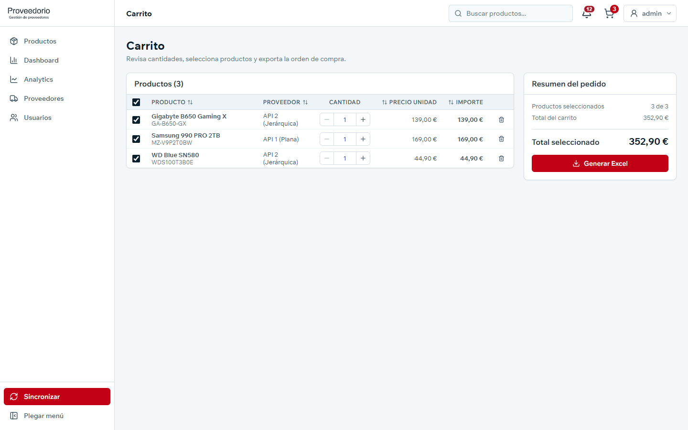

<div align="center">

<p align="center">
  <picture>
    <source 
      media="(prefers-color-scheme: dark)" 
      srcset="frontend/src/assets/ProveedoresLogo_Light.png"
    >
    <source 
      media="(prefers-color-scheme: light)" 
      srcset="frontend/src/assets/ProveedoresLogo_Dark.png"
    >
    
  </picture>
</p>

### Un único catálogo para todos tus proveedores

Proveedorio conecta con las APIs de distintos proveedores mayoristas, unifica sus catálogos aunque cada uno hable "su propio idioma", y te ayuda a decidir **a quién comprar, a qué precio y cuándo**.

<br>


<br>


<br>



</div>

---

## El problema

Un comprador que trabaja con varios mayoristas tiene que consultar cada catálogo por separado: uno devuelve un JSON plano, otro anida la marca dentro de un objeto `manufacturer`, otro guarda las especificaciones como pares clave-valor y otro es un sistema legacy. Comparar precios del mismo producto entre proveedores, vigilar el stock o detectar una buena oferta se convierte en trabajo manual.

## La solución

Proveedorio actúa como capa intermedia entre el comprador y sus proveedores:

1. **Conecta** con la API de cada proveedor.
2. **Traduce** sus datos al mismo formato mediante reglas de mapeo configurables desde la propia interfaz, sin tocar código.
3. **Unifica** los productos por MPN en un catálogo consolidado, con todas las ofertas de cada producto juntas.
4. **Analiza** precios, stock y márgenes para destacar oportunidades de compra.
5. **Genera** la orden de compra en Excel a partir del carrito.



---

## Un recorrido por la aplicación

### Inventario consolidado

Todos los productos de todos los proveedores en un solo lugar, con su precio mínimo, disponibilidad y número de proveedores que los ofrecen. Se puede buscar por modelo, marca o MPN, filtrar por especificaciones técnicas (`ram:32GB`, `socket:AM5`…) y alternar entre vista de tabla y de tarjetas.

<p align="center">
  
  
</p>

### Comparar ofertas de un producto

Cada producto reúne las ofertas de todos los proveedores que lo venden: precio de partner, PVP, stock, estado y última sincronización. Desde aquí se añade la mejor oferta al carrito o se consulta el histórico de precios de cada proveedor.

<p align="center">
  
</p>

### Dashboard y analytics

El **dashboard** muestra de un vistazo el estado del catálogo: productos disponibles, en bajo stock o agotados, latencia de las APIs y el resultado de las sincronizaciones de los últimos días. Todo se puede exportar en un ZIP.

**Analytics** va un paso más allá con cuatro áreas: **Oportunidades** (el "radar de ofertas", ordenado por la mayor brecha entre el mejor coste y el PVP), **Precios** (dispersión, estabilidad y variación), **Stock** (volatilidad y roturas) y **Catálogo** (crecimiento y composición).

<p align="center">
  
</p>

### Proveedores sin código

Añadir un proveedor nuevo no requiere programar. Basta con indicar la URL de su API y definir cómo se traduce cada campo externo a un campo interno. Hay cuatro tipos de transformación:

| Transformación | Para qué sirve | Ejemplo |
| --- | --- | --- |
| `DIRECT` | El campo se lee tal cual | `price` → `price` |
| `NESTED` | El valor está dentro de otro objeto | `manufacturer.name` → `brand` |
| `FIND_IN_ARRAY` | El valor está en una lista de atributos | `attributes[key=socket]` → `spec_socket` |
| `SPLIT` | Un campo agrupa varios valores | `"E-ATX;DDR5;USB4"` → `spec_feat_0`, `spec_feat_1`… |

Cada proveedor tiene además su propio dashboard con los productos vinculados, su stock y la latencia de sincronización.

<p align="center">
  
  
</p>

### Del carrito a la orden de compra

Las ofertas elegidas se acumulan en el carrito, agrupadas con su proveedor. Desde ahí se ajustan cantidades, se seleccionan las líneas y se genera la orden de compra en Excel con un clic.

<p align="center">
  
</p>

### Y además

- **Sincronización automática** con todos los proveedores al arrancar y cada 6 horas, además de un botón de sincronización manual.
- **Historial de precios y stock** por producto y proveedor, con gráfica de evolución y estadísticas.
- **Notificaciones** de errores de sincronización, nuevas ofertas y productos nuevos.
- **Conversión de divisas** con los tipos de cambio diarios del Banco Central Europeo.
- **Usuarios y roles** (administrador y cliente) con inicio de sesión seguro.
- **Monitorización** del sistema con Prometheus y Grafana.

---

## Bajo el capó

| Capa | Tecnología |
| --- | --- |
| Frontend | React + TypeScript (Vite), TanStack Query, servido con Nginx |
| Backend | Java 21, Spring Boot, Spring Security con JWT |
| Datos | MariaDB |
| Secretos | HashiCorp Vault |
| Observabilidad | Prometheus, Grafana Alloy y Grafana |
| Infraestructura | Docker Compose, GitHub Actions, imágenes en GHCR |

Las cuatro APIs de proveedores de ejemplo se simulan con un servidor JSON incluido en el proyecto, de modo que la aplicación funciona completa en local, sin servicios externos.

---

## Probarlo en local

Solo necesitas **Docker Desktop**.

```bash
# 1. Copia las variables de entorno (en Windows: copy .env.example .env)
cp .env.example .env

# 2. Levanta todo el stack
docker compose up -d --build
```

Cuando termine, abre **http://localhost:8081** e inicia sesión con:

| Usuario | Contraseña |
| --- | --- |
| `admin` | `admin123` |

Al arrancar, la aplicación sincroniza automáticamente los cuatro proveedores de ejemplo, así que el catálogo aparece ya poblado.

Grafana queda disponible en http://localhost:3000 y Prometheus en http://localhost:9090.

> Variables de entorno, Vault, logs, reverse proxy y CI/CD: consulta la **[guía técnica](docs/SETUP.md)**.

---

## Autores

- [@lukellorente](https://github.com/lukellorente)
